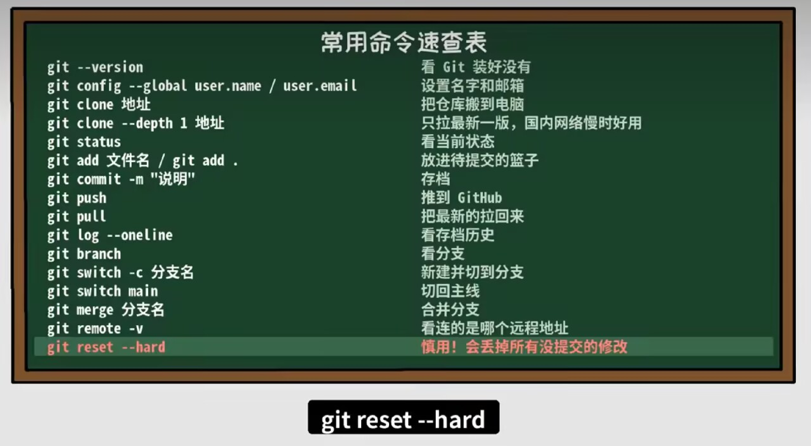

# git 常用命令

> 给第一次用 Git 的队友。先看懂这张图，再照「每日流程」走一遍，就够用了。



## 命令表

| 命令 | 说明 |
| --- | --- |
| `git --version` | 看 Git 装好没有 |
| `git config --global user.name` / `user.email` | 设置名字和邮箱（一次性） |
| `git clone 地址` | 把仓库搬到自己电脑 |
| `git clone --depth 1 地址` | 只拉最新一版，网络慢时好用 |
| `git status` | 看当前状态：改了哪些文件、有没有待提交 |
| `git add 文件名` / `git add .` | 放进待提交的「篮子」 |
| `git commit -m "说明"` | 存档（一定要写清做了什么） |
| `git push` | 推到 GitHub |
| `git pull` | 把远端最新的拉回来 |
| `git log --oneline` | 看提交历史 |
| `git branch` | 看分支 |
| `git switch -c 分支名` | 新建并切到分支 |
| `git switch main` | 切回主线 |
| `git merge 分支名` | 合并分支（本地用；网页上用 PR） |
| `git remote -v` | 看连的是哪个远端地址 |
| `git reset --hard` | ⚠️ 慎用，会丢掉所有没提交的修改 |

## 每日流程（六条，照着打）

```bash
git pull                                   # 1. 先拉，别人可能改过
git switch -c feat/align-symbol-recall     # 2. 开分支，一件事一个
git status && git add -A                   # 3. 看清要提交什么
git commit -m "feat(align): 加入符号路候选召回"  # 4. 提交
git push -u origin HEAD                    # 5. 推上去
# 6. 网页开 PR → 点开 Files changed 看一眼 → 合并 → 删分支
```

## 三条红线

1. **不直接改 main。** 所有改动走分支 + PR。
2. **不提交照片、APK、docx、模型权重。** 单个超过 1 MB 就先停手问一句。
3. **不提交密钥。** API Key 一律走环境变量。

## 常见翻车与救法

| 症状 | 原因 | 怎么办 |
| --- | --- | --- |
| `push` 被拒：`rejected (fetch first)` | 远端有你本地没有的提交 | 先 `git pull --rebase`，再 `git push`；冲突就按提示改完 `git add` 后 `git rebase --continue` |
| 分支切不动：`Your local changes would be overwritten` | 有没提交的改动 | `git stash` 存起来 → 切分支 → 回来 `git stash pop` |
| 提交里混进了不该提交的文件 | `git add .` 太顺手 | 还没推：`git reset HEAD~1` 重来；已推：`git revert` 或直接删文件再提交一次 |
| 中文文件名显示成 `\344\273\223` | Git 默认转义 | `git config --global core.quotepath false` |
| 手滑 `git reset --hard` 丢了一天活 | 未提交的改动无法恢复 | 只能靠编辑器历史；所以**每 20 分钟 commit 一次**是最便宜的保险 |
| 把密钥推上去了 | — | 立刻吊销该 Key，再处理历史（只删文件没用） |
| 仓库越来越大 | 提交过大文件 | `git count-objects -vH` 看体积；二进制请移到 Releases |

## 提交前三十秒自检

- [ ] 只改了这一件事？
- [ ] 提交信息能让三个月后的自己看懂？
- [ ] `git status` 里没有 `data/`、`build/`、`.env`、`*.docx`？
- [ ] 文档能正常渲染（表格、代码块没断）？

> 完整的团队规矩见 [`../CONTRIBUTING.md`](../CONTRIBUTING.md)。
